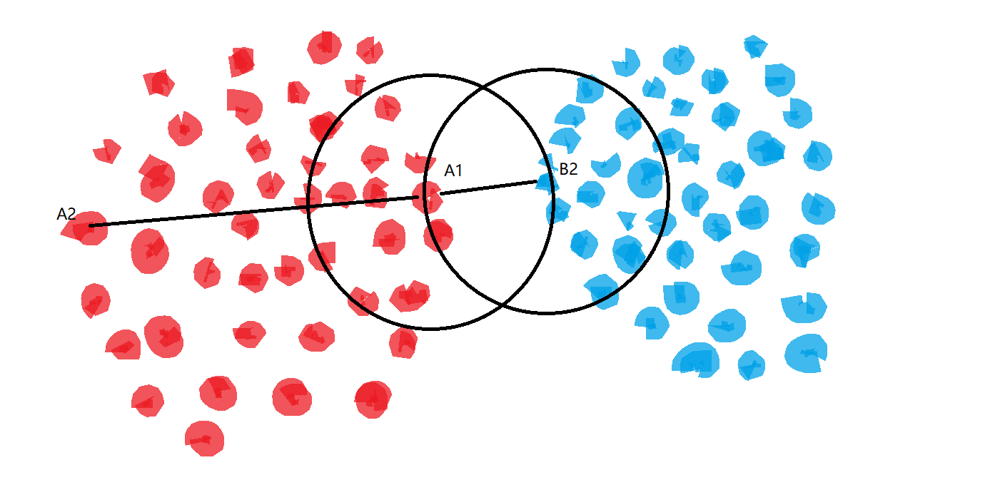
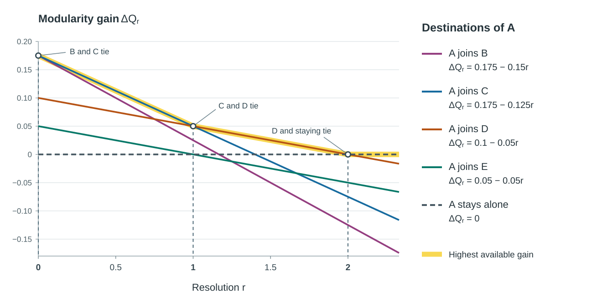

# Louvain clustering on SNN graphs and maximization of classical modularity

For a fixed neighbor count $k$, consider a Jaccard shared nearest-neighbor (SNN) graph with positive total edge weight. With all choices except the resolution $r$ fixed, we prove that every partition returned by the Louvain procedure defined here can be enumerated in time polynomial in the number of cells $n$. The same algorithm identifies every partition attaining the highest classical modularity among those outputs. We begin with the meaning of a single entry in the SNN matrix.

## 1. Shared neighborhoods determine the SNN graph

For $n$ cells, the SNN graph can be represented by an $n\times n$ matrix. Each entry $A_{ij}$ measures the connection strength between cells $i$ and $j$. In single-cell sequencing analysis, each highly variable gene supplies one dimension. We can reduce the expression data to $d$ dimensions and compare the overlap between the two cells’ nearest-neighbor sets in that space.

### Jaccard similarity measures the overlap between two cells’ neighborhoods

For cell $i$, take its $k$ nearest neighbors under a chosen distance measure and call this set $N_i$. Define $N_j$ in the same way. Let $x$ be the number of shared neighbors. Each set has $k$ elements, so their intersection has $x$ elements and their union has $2k-x$. If the edge is retained, its weight is the Jaccard similarity of the two sets.

$$
A_{ij}=\dfrac{\lvert N_i\cap N_j\rvert}{\lvert N_i\cup N_j\rvert}=\dfrac{x}{2k-x},\qquad 0\le x\le k.
$$

Weak edges may be pruned. For example, with Seurat’s commonly used defaults $k=20$ and a pruning threshold of $1/15$ (`prune.SNN`), two shared neighbors give $\tfrac{2}{38}<\tfrac{1}{15}$, whereas three give $\tfrac{3}{37}>\tfrac{1}{15}$. At least three shared neighbors are therefore needed to exceed this threshold. We allow symmetric pruning by setting the corresponding matrix entries to zero, and we set $A_{ii}=0$. This gives an undirected graph without self-loops.

### Neighborhood overlap captures information from surrounding cells

In the figure, $A_1$ is closer to $B_2$ than to $A_2$ by point-to-point distance. Yet most neighbors of $A_1$ belong to the red group, and most neighbors of $B_2$ belong to the blue group. Their neighborhoods have little overlap. The SNN matrix entry for $A_1$ and $B_2$ therefore carries information about the cells around them.

## 2. Modularity measures how within-community connectivity deviates from its random expectation

Treat each cell as a vertex. For a given partition, classical modularity measures the difference between the observed weight of connections within communities and the weight expected under a random reference model. Let $X$ denote a partition and $c_X(i)$ the community label of cell $i$. Write $\delta_X(i,j)=1$ if $i$ and $j$ belong to the same community, and $\delta_X(i,j)=0$ otherwise.

$$
k_i=\sum_j A_{ij},\qquad 2m=\sum_i k_i=\sum_{i,j} A_{ij}.
$$

The sum of edge weights in row $i$, denoted by $k_i$, is the weighted degree of cell $i$. The neighbor count $k$ is fixed when the graph is built. Let $m$ be the total weight of the undirected edges, counting each edge once, and assume $m>0$ throughout. The sum $\sum_{i,j}$ runs over ordered pairs, so each undirected edge contributes twice to $2m$.

### The resolution $r$ scales the expected connection weight

$$
Q_r(X)=\dfrac{1}{2m}\sum_{i,j}\left[A_{ij}-r\dfrac{k_i k_j}{2m}\right]\delta_X(i,j).
$$

In the reference model for modularity, vertex $i$ accounts for a fraction $k_i/(2m)$ of the total weighted degree. Allocating the weighted degree of $j$ according to this fraction gives an expected connection weight of $k_j k_i/(2m)$ between $j$ and $i$. Setting $r=1$ recovers classical modularity, $Q(X)=Q_1(X)$.

We can group the terms by community. Write $e(C)$ for the total weight of edges within community $C$, counting each edge once, and $K(C)$ for the sum of its cells’ weighted degrees. Summing over communities gives

$$
Q_r(X)=\sum_{C\in X}\left[\dfrac{e(C)}{m}-r\left(\dfrac{K(C)}{2m}\right)^2\right].
$$

### Main theorem

Fix a positive integer $k$. Let $G$ be any Jaccard SNN graph on $n$ cells that satisfies the conditions in Section 1 and has $m>0$. Fix the visit order, move rule, and tie-breaking rule specified in Section 3. Write $L_G(r)$ for the final partition returned by Louvain at resolution $r$. The set of interest is

$$
\mathcal{R}(G)=\left\{L_G(r)\mid r\in\mathbb{R},\ r\ge 0\right\}.
$$

There exist an algorithm and a constant $C_k$ depending only on $k$ such that, for every such $n$ and $G$, the algorithm lists all distinct partitions in $\mathcal{R}(G)$ in at most $C_k n^{14}$ unit-cost operations. It reports the classical modularity of each partition, ranks the partitions with equal scores tied, and identifies every maximizer. Each exact scalar arithmetic operation, comparison, or random access has constant cost in this model.

The theorem gives the maximum classical modularity among the partitions reachable by Louvain and every partition attaining it. Even at $r=1$, choosing the best available move at each step need not yield the globally highest $Q$ among all partitions of $n$ cells. On general graphs, deciding whether any partition reaches a given modularity threshold is NP-complete ([Brandes et al., 2008](https://doi.org/10.1109/TKDE.2007.190689)). Here the candidate set is $\mathcal{R}(G)$.

## 3. At a fixed resolution, Louvain moves units in sweeps and contracts the graph

Fix $r\ge 0$ and start with each cell in its own community. We call a movable vertex at the current level a unit. At the first level, a unit is a single cell. After contraction, it is a community from the preceding level. The original cell numbering and visit order are fixed in advance. If `random.seed` is used to generate the order, the resulting initial numbering is held fixed.

**Step 1. The algorithm considers one unit’s possible moves at a time**

At the start of each level, each unit forms its own community. Its initial label is the smallest original cell index in that unit, and the units are visited in order of these indices. When visiting a unit, the algorithm considers staying in its current community or joining a neighboring community. A community is neighboring if at least one other unit in it is connected to the current unit by an edge of positive weight. Staying gives modularity gain zero.

**Step 2. The algorithm chooses a destination and proceeds to the next unit**

For each destination, compare $\Delta Q_r$ relative to the current partition. If the largest gain is strictly positive, choose a destination attaining it. If several destinations tie for the largest positive gain, choose the one with the smallest current community label. If the largest gain is zero, the unit stays. A unit that moves takes the destination community’s existing label. In either case, the algorithm proceeds to the next unit, using the updated partition.

**Step 3. A sweep containing a move triggers another sweep**

One visit to every unit at the current level constitutes a sweep. If any unit moves during the sweep, the algorithm repeats the sweep in the same order. A sweep with no moves ends the scanning phase at that level.

**Step 4. The algorithm contracts the graph or returns the partition**

If there are fewer communities than there were units at the start of the level, contract each community into one unit for the next level. Label each new unit by the smallest original cell index it contains and aggregate the edge weights between units from the original graph. Start the new level at Step 1. If the number of units has not decreased, map the current community assignments back to the $n$ original cells and return the resulting partition.

### Five cells illustrate one local choice

The initial partition is $X_0=\{\{A\},\{B\},\{C\},\{D\},\{E\}\}$. Suppose $A$ is visited first and has an edge to each of the other four cells. It then has four possible moves, as well as the option of staying. Joining $B$ yields $\{\{A,B\},\{C\},\{D\},\{E\}\}$, while joining $C$ yields $\{\{B\},\{A,C\},\{D\},\{E\}\}$. If $A$ is connected to only two of the other cells, only those two neighboring communities and its current community are considered.

If $A$ joins $C$, the next cell $B$ sees a partition containing $\{A,C\}$. If $A$ stays, $B$ is still visited next. In what follows, choosing a destination refers to one local decision, a sweep visits every unit at the current level once, and a complete run proceeds through to the final partition.

## 4. The modularity gain of each candidate move is affine in the resolution

### Lemma 1. Each candidate move has a fixed intercept and slope

Consider moving unit $i$ from community $A$ to community $B$. Let $A^-$ denote what remains of $A$ after removing $i$. Write $w_{i,B}$ and $w_{i,A^-}$ for the total weights of the edges from $i$ to the respective communities, and $K_B$ and $K_{A^-}$ for their total weighted degrees. Let $d$ be the sum of the weighted degrees of the original cells in unit $i$. At the first level, $d=k_i$.

**Proof.** The move adds the edges between $i$ and $B$ to the within-community edges and removes those between $i$ and $A^-$. The total weight of within-community edges therefore changes by $w_{i,B}-w_{i,A^-}$. In the expected term of modularity, each community contributes the square of its total weighted degree. Only the source and target contributions change. The change in the sum of squares is

$$
(K_B+d)^2+K_{A^-}^2-K_B^2-(K_{A^-}+d)^2=2d(K_B-K_{A^-}).
$$

Substituting these two changes into the modularity formula gives

$$
\Delta Q_r=\dfrac{w_{i,B}-w_{i,A^-}}{m}-r\,\dfrac{d(K_B-K_{A^-})}{2m^2}=a+br.
$$

The partitions before and after this candidate move fix $a$ and $b$. Their values may differ from one candidate move to another. If we plot the candidate lines on the same axes, the highest line at a given $r$ identifies a choice with the largest gain when unit $i$ is visited.

### The heights of the candidate lines at a given resolution determine which move A takes

The figure illustrates one decision on a weighted graph. The horizontal axis shows $r$, the vertical axis shows $\Delta Q_r$, and the yellow line traces the largest available gain. For $0<r<1$, $A$ joins $C$. For $1<r<2$, $A$ joins $D$. For $r>2$, $A$ stays in its original community. A general weighted graph can realize the coefficients in this figure exactly. Section 9 works through a full clustering run on a Jaccard SNN graph.

At the boundaries, take the labels in increasing order $B,C,D,E$. At $r=0$, $B$ and $C$ tie, so $A$ joins $B$. At $r=1$, $C$ and $D$ tie, so $A$ joins $C$. At $r=2$, the largest gain is zero, so $A$ stays in its original community. The figure describes the decision made when $A$ is visited. The final partition also depends on the units visited later and on subsequent sweeps.

## 5. The number of distinct modularity scores is polynomially bounded at a fixed resolution

### Lemma 2. For a fixed graph and resolution, there are at most $O(n^6)$ distinct scores

Choose any $n$ and fix a graph satisfying the assumptions. On this graph we vary the partition. The quantities $A_{ij}$, $k_i$, and $2m$ are fixed, while the indicator $\delta_X(i,j)$ records whether cells $i$ and $j$ belong to the same community in partition $X$. The denominator may change with the graph or with $n$. We seek a bound that applies to every such graph.

**Proof.** As shown above, the number $x$ of shared neighbors can take only the values $0,1,\ldots,k$, so $A_{ij}$ has at most $k+1$ possible values. These values also have a common denominator independent of $n$. Set $T=(2k)!$. Every possible denominator $2k-x$ divides $T$, so every $T A_{ij}$ is an integer in $[0,T]$. Let $W=2mT$. Then $W$ is the sum of all entries $T A_{ij}$ and satisfies $0<W\leq Tn^2$.

### The observed term takes at most $O(n^2)$ distinct values

$$
U(X)=\sum_{i,j}(T A_{ij})\,\delta_X(i,j),\qquad \text{observed term}=U(X)/W.
$$

There are $n^2$ entries, and an indicator of zero or one determines whether each enters the sum. The numerator $U(X)$ is a nonnegative integer. Including every edge weight gives the upper bound $W$. Since $W$ is fixed on the given graph, the observed term takes at most $W+1\leq Tn^2+1$ distinct values.

### The coefficient of the expected term takes at most $O(n^4)$ distinct values

$$
V(X)=\sum_{i,j}(T k_i)(T k_j)\,\delta_X(i,j),\qquad \text{coefficient of the expected term}=V(X)/W^2.
$$

The integer $T k_i$ is the sum of the integer edge weights in row $i$, so it is at most $Tn$. Each product is at most $T^2n^2$, and summing $n^2$ such products gives at most $T^2n^4$. On a fixed graph there is a more direct bound. Replacing every indicator by one gives $(\sum_i T k_i)^2=W^2$. Thus $V(X)$ is an integer in $[0,W^2]$ and takes at most $W^2+1$ distinct values.

### The two integer coefficients determine the modularity score

$$
Q_r(X)=U(X)/W-r\,V(X)/W^2=[W U(X)-r V(X)]/W^2.
$$

For fixed $r$, each pair of integers $U(X),V(X)$ determines one score. Across all partitions, the number of distinct scores is therefore at most

$$
(W+1)(W^2+1)\leq(Tn^2+1)(T^2n^4+1)=T^3n^6+T^2n^4+Tn^2+1.
$$

For fixed $k$, $T$ is constant, giving the bound $O(n^6)$. This counts distinct scores, and many partitions may have the same score. As $r$ varies, even a single nonconstant line can take infinitely many values. The set of integer coefficient pairs that specify the lines remains finite.

## 6. Louvain terminates after finitely many sweeps at a fixed resolution

### Lemma 3. One complete run takes at most $O(n^8)$ operations

The move-selection rule in Section 3 accepts a move only if it strictly increases $Q_r$. Within a level, each accepted move therefore reaches a higher score. To count accepted moves over a complete run, we must also show that contraction preserves the score measured on the original graph.

At contraction, regard the communities as blocks. Define the weight $A'_{BD}$ between blocks $B$ and $D$ to be the sum of $A_{ij}$ over all $i\in B$ and $j\in D$. The weighted degree of a block then equals the sum of the weighted degrees of its original cells. This calculation includes the diagonal contribution $A'_{BB}$, in which each undirected edge internal to $B$ is counted in both directions. For any partition of the blocks, assigning each original cell its block's community label gives the same $U$ and $V$ as a calculation on the original graph. Both calculations sum the same ordered pairs, grouped differently.

Thus contraction preserves $Q_r$. At the same fixed $r$, from the first level to the last, every accepted move strictly increases the score on the original graph. By Lemma 2, there can be at most $(W+1)(W^2+1)-1$ accepted moves in total.

### The number of accepted moves bounds the number of sweeps

Each sweep that changes the partition accounts for at least one accepted move. Each level also requires a final sweep with no moves to establish that the level is complete. The algorithm begins a new level only when the number of units strictly decreases, so there are at most $n$ levels. Hence

$$
\text{total sweeps}\leq\text{total accepted moves}+n=O(n^6).
$$

This also proves termination at each fixed $r$. The original labels, visit order, and all tie-breaking rules are fixed, so each $r$ has a unique final output $L_G(r)$.

### One sweep takes at most $O(n^2)$ operations

This cost can be read directly from the entries of the SNN matrix. When a unit moves, contributions whose same-community indicators are unchanged cancel in the difference between the two scores. Initially, if $A$ and $B$ are singletons, moving $A$ into $B$ changes only the indicators at $(A,B)$ and $(B,A)$. A move from a larger community can also change indicators from one to zero. Lemma 1 sums exactly the contributions gained and lost.

When visiting a unit, first aggregate its incident edge weights by the neighbors' current communities and obtain the total weighted degree of each community. Evaluating Lemma 1 then takes a constant number of operations per candidate. Accumulating the weights across a row and comparing all neighboring communities takes at most $O(n)$ operations for one unit and $O(n^2)$ for an entire sweep. Recomputing modularity entry by entry for every candidate would overestimate this cost.

The weights between blocks and original cells can be aggregated at the start of each level. Even with the dense tables in the formally verified algorithm, building the tables takes $O(n^3)$ operations per level and at most $O(n^4)$ over all levels. The total cost of one complete run is therefore

$$
O(n^6)\times O(n^2)+O(n^4)=O(n^8).
$$

## 7. The number of critical resolution values remains finite as the resolution varies

### Lemma 4. There are at most $O(n^6)$ possible critical resolution values

When a unit chooses between two candidate partitions $X$ and $Y$, both gains subtract the score of the same partition before the move. We can therefore compare $Q_r(X)$ and $Q_r(Y)$ directly. Staying in the current community is also a candidate, so this comparison includes the case in which a proposed move has exactly zero gain.

**Proof.** Set $\Delta U=U(X)-U(Y)$ and $\Delta V=V(X)-V(Y)$. By Lemma 2, the two score lines agree at resolution $r$ exactly when

$$
W\Delta U-r\Delta V=0,\qquad r=\frac{W\Delta U}{\Delta V}\quad(\Delta V\ne 0).
$$

If $\Delta V=0$ and $\Delta U\ne0$, the lines are parallel. If both differences are zero, the lines coincide and remain tied at every resolution. In the remaining cases, $\Delta U$ is an integer in $[-W,W]$ and $\Delta V$ is a nonzero integer in $[-W^2,W^2]$. Form all such ratios, retain the nonnegative values, and include the starting point $0$. The resulting set $B$ of candidate boundaries satisfies

$$
|B|\le 1+(2W+1)(2W^2+1)=O(n^6).
$$

This also explains the intuition behind counting gain lines. The differences between the coefficients before and after a move determine its $\Delta Q_r$ line, so there are at most $O(n^6)$ possible gain lines. The number of lines alone does not give the same bound on their intersections. The ratio above counts the distinct horizontal coordinates directly. It covers comparisons at every unit, sweep, and contraction, so we can construct $B$ without first enumerating all partitions.

### Lemma 5. The entire execution is identical between consecutive boundaries

Sort $B$ in increasing order and choose any two resolutions in the same open interval between consecutive boundaries. Both runs start from the same partition. Whenever their current states agree, the available destinations and current community labels also agree. The score difference between any two destinations is affine in $r$. Throughout this interval it either vanishes identically or has constant sign, since every isolated zero already belongs to $B$.

The two runs therefore select the same destination and reach the same next state. Repeating the argument at the next unit, the next sweep, and the next contraction shows that every decision agrees. Lemma 3 guarantees termination in finitely many steps, so both runs return the same partition. The same argument applies to the open interval beyond the last boundary.

Each boundary point also requires a separate evaluation. A destination can tie for the highest score only at that point and win under the fixed label rule. Evaluating the intervals on either side would miss this possibility. This observation turns finiteness into a guarantee of exhaustive enumeration.

## 8. Evaluating boundary points and open intervals enumerates all reachable partitions

### The enumeration algorithm uses a finite set of representatives

**Step 1. The candidate boundaries divide the resolution axis into intervals**

Iterate over the integer differences $\Delta U,\Delta V$ from Lemma 4 to generate $B$, remove duplicates, and sort the remaining values. Check the open intervals between consecutive points and the open interval to the right of the last point.

**Step 2. One full run at each representative yields the partitions to record**

Run the procedure from Section 3 at each boundary point. For each bounded open interval, run it at the midpoint of the two endpoints. For the final unbounded interval, run it at its left endpoint plus $1$. Record each final partition in terms of the original cells, using the smallest cell index in each community as its canonical label. Keep one copy of each distinct partition.

**Correctness.** Fix any $r\ge0$. If $r\in B$, the algorithm evaluates $r$ itself. If $r$ lies in an open interval, Lemma 5 guarantees that its output agrees with the output at the representative. Conversely, every recorded partition is attained at an actual nonnegative rational resolution. Thus the algorithm lists $X$ if and only if $L_G(r)=X$ for some $r\ge0$.

### The implementation finds the next boundary along the current execution

Consider the diagram for $A$ again. At exactly $0$, $A$ joins $B$. Immediately to the right of $0$, the gain lines for $B$ and $C$ start at the same height, but the line for $C$ has the greater slope, so $A$ joins $C$. If the slopes also agree, the two lines coincide and the original tie rule applies. No choice of a small numerical step is necessary.

At each boundary, the implementation follows two executions, one at the boundary itself and one immediately to its right. Along the entire right-hand execution, each time a unit chooses a destination, the algorithm records the earliest future resolution at which a competing line could catch the selected line. The earliest of these values over all choices is the next boundary to evaluate. If there is no such value, the current result holds all the way to infinity. Until that boundary, every comparison leading to a choice is preserved. This procedure therefore covers exactly the same output set as the boundary-list algorithm above.

## 9. Small graphs verify local choices and final partitions

### The edge weights determine the four gain lines for A

The five-cell diagram in Section 4 illustrates how a unit chooses its destination. Its lines can be reproduced on an undirected weighted graph with the following weights, where $AB$ denotes the edge joining $A$ and $B$.

$$
AB=AC=7,\quad AD=4,\quad AE=2,\quad BC=12,\quad BD=2,
$$

$$
BE=3,\quad CD=0,\quad CE=1,\quad DE=2.
$$

The edge weights sum to $m=40$, and the weighted degrees of the five cells in order are $20,24,20,8,8$. Starting from singletons, the gain when $A$ joins $B$ is $7/40-r(20)(24)/(2\cdot40^2)=0.175-0.15r$. Substituting the edge weights and weighted degrees for $C$, $D$, and $E$ gives the other three lines in the diagram. This example shows why choices at the endpoints require separate evaluation. The next example verifies final partitions on an SNN graph satisfying the main theorem.

### A Jaccard SNN graph can be checked from its neighbor lists to its final outputs

Let $n=3$ and $k=2$, with the other two cells serving as the neighbors of each cell. Any two neighbor sets have one element in their intersection and three in their union. Retain all off-diagonal edges. All three edge weights are $1/3$, each cell has weighted degree $2/3$, and $m=1$.

Initially each cell forms its own community. By Lemma 1, merging any pair of singletons gives

$$
\Delta Q_r=1/3-2r/9.
$$

For $0\le r<3/2$, this gain is strictly positive, so the first visit merges a pair. The gain when the remaining singleton joins the pair is $2/3-4r/9$, twice the gain above, and is also strictly positive. If one of the paired cells were to move to the singleton's community, the two resulting communities would have the same sizes as before and the score would be unchanged. The algorithm therefore declines that move. All three cells ultimately belong to a single community.

At $r=3/2$, every possible first merge has gain zero and each cell stays in its own community. For $r>3/2$, all these gains are negative, so again no cell moves. Both cases end with three singleton communities and require no contraction.

### Classical modularity scores both outputs on the same scale

$0\le r<3/2$: all three cells in one community, $Q=1-1^2=0$.

$r\ge3/2$: three singleton communities, $Q=0-3(1/3)^2=-1/3$.

Over all nonnegative real resolutions this graph produces exactly two distinct partitions. Scoring both at resolution $1$ gives the higher classical modularity to the single community containing all three cells. Varying $r$ recovers the candidate partitions, and the same classical $Q$ scores both.

## 10. The total operation count yields the main conclusion

### The costs of covering all resolutions combine to give the bound

For a given matrix, converting the edge weights to integers and summing its rows takes $O(n^2)$ operations. There are $|B|$ candidate boundaries and $|B|$ open intervals, so the algorithm checks $L=2|B|=O(n^6)$ resolution values. Forming the candidate fractions, sorting them, and removing duplicates takes at most $O(n^6\log(n+1))$ operations. By Lemma 3, a full run at each value costs at most $O(n^8)$ operations. The main contribution to the total is

$$
\text{number of resolution values}\times\text{sweeps per value}\times\text{cost per sweep}
$$

$$
=O(n^6)\times O(n^6)\times O(n^2)=O(n^{14}).
$$

The implementation that finds boundaries as needed satisfies the same bound. Every boundary it visits lies in $B$, and successive boundaries strictly increase. The right-hand execution at any boundary agrees with an actual run at a resolution in the adjacent open interval on its right. An extra scan of the candidate lines at each destination choice finds the next possible crossing, leaving the cost of a sweep at $O(n^2)$.

Let $M$ be the number of distinct partitions, so $M\le L$. Canonically label each community by its smallest cell index. Even comparing every pair of outputs, inspecting $n$ cell labels per comparison, takes only $O(nL^2)=O(n^{13})$ operations to remove duplicates.

### Ranking by classical modularity identifies every tied maximizer

For each distinct $X$, compute its classical modularity $Q(X)=[WU(X)-V(X)]/W^2$ once. Scanning the $n^2$ entries of the original graph gives $U$ and $V$, so scoring all partitions takes at most $O(Mn^2)$ operations. All scores share a denominator, and comparing their integer numerators gives the exact ordering and all ties. A full ranking takes $O(M\log(M+1))$ comparisons. A single scan of the scores suffices to select all maximizers. The score table returned by the implementation already marks all ties for the maximum, and its scores can be used directly for sorting.

### The main theorem follows

Fix every parameter and rule other than $r$ and run the Louvain procedure defined here on a given $n\times n$ Jaccard SNN graph. For fixed $k$ and positive total edge weight, an $O(n^{14})$ algorithm enumerates every distinct partition that can be returned at any nonnegative real resolution $r$, and supplies the classical modularity $Q$ of each partition together with the ranking. This proves the main theorem of Section 2.

**In brief,** when resolution is the only variable, $O(n^{14})$ operations suffice to identify the partition of highest classical modularity among all reachable outputs of this Louvain procedure, including every partition tied for the maximum. The returned set is exactly

$$
\{X\in\mathcal{R}(G)\mid Q(X)=\max_{Y\in\mathcal{R}(G)}Q(Y)\}.
$$

For a rational threshold $q$, the decision criterion is $Q(L_G(r))\ge q$ for some $r\ge0$. Comparing the maximum score with $q$ decides it. For fixed $k$, $W=O(n^2)$. The numerators and denominators of the critical resolutions and of midpoints between consecutive boundaries all have magnitudes polynomial in $n$. Comparisons can use integer cross-multiplication, with $O(\log(n+1))$ bits for these quantities and the additional input bit length of $q$ in the final comparison. Thus the decision problem belongs to $\mathrm{P}$ in the usual binary input model.
